 

<a href="#selected-work">WORK</a> &nbsp;·&nbsp; <a href="#toolkit">TOOLKIT</a> &nbsp;·&nbsp; <a href="#contact">CONTACT</a>

 

## Selected work

<table>
<tr>
<td width="50%" valign="top">

### [QuantaLab ↗](https://thequantalab.vercel.app/)

An interactive 3D double-slit experiment. Explore wave and particle modes, change the wavelength, and watch the probability distribution respond.

**Next.js** · **TypeScript** · **Three.js**

[Source](https://github.com/eyadaldaoud/QuantaLab)

</td>
<td width="50%" valign="top">

### [CrossPost Bot ↗](https://github.com/eyadaldaoud/cross-post-bot)

A Telegram workflow for publishing video to Instagram Reels and Facebook Pages, with retry-safe processing.

**Next.js** · **Supabase** · **Telegram** · **Meta API**

</td>
</tr>
<tr>
<td width="50%" valign="top">

### [MailCleaner ↗](https://github.com/eyadaldaoud/mail-cleaner)

A Gmail cleanup dashboard with bulk actions and saved rules. It processes message metadata without storing email content.

**Next.js** · **Google OAuth** · **Supabase**

</td>
<td width="50%" valign="top">

### [Fawtara ↗](https://eyadg.netlify.app)

A bilingual invoice builder with RTL layouts, four templates, live preview, and PDF export.

**Next.js** · **TypeScript** · **Supabase**

</td>
</tr>
</table>

 

## Toolkit

**INTERFACES**

  

**BACKEND & DATA**

 

## GitHub activity

 

## Contact

 
Building useful things, one thoughtful detail at a time.

