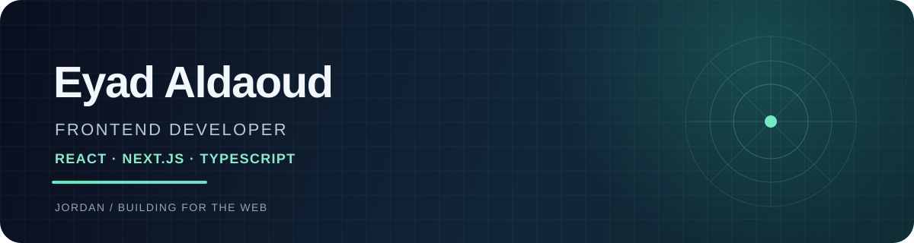

 

### I build useful web products with React, Next.js, and TypeScript.

Based in Jordan · Interested in frontend engineering and product-focused teams

[Portfolio](https://eyadg.netlify.app) &nbsp;·&nbsp; [Projects](https://github.com/eyadaldaoud?tab=repositories) &nbsp;·&nbsp; [Email](mailto:eyadzoubi40@gmail.com)

 

## What I build with

  

Responsive interfaces, thoughtful product flows, API integrations, and bilingual Arabic/English experiences with right-to-left layouts.

## Featured projects

| Project | What it does | Stack |
|:--|:--|:--|
| [⚛️ QuantaLab](https://github.com/eyadaldaoud/QuantaLab) · [Live](https://thequantumbench.vercel.app/) | Interactive 3D Double-Slit lab with wave/particle modes, wavelength controls, and a live probability distribution. | `Next.js` `TypeScript` `Three.js` |
| [📣 CrossPost Bot](https://github.com/eyadaldaoud/cross-post-bot) | Publishes video to Telegram, Instagram Reels, and Facebook Pages from Telegram, with retry-safe processing. | `Next.js` `Supabase` `Telegram` `Meta API` |
| [📬 MailCleaner](https://github.com/eyadaldaoud/mail-cleaner) | Gmail cleanup dashboard with bulk actions and saved rules; processes metadata without storing message content. | `Next.js` `Google OAuth` `Supabase` |
| [🧾 Fawtara](https://eyadg.netlify.app) | Arabic/English invoice builder with RTL layouts, four designs, live preview, and PDF export. | `Next.js` `TypeScript` `Supabase` |

## Selected impact

- Improved web app load times by **20%** and reduced post-release defects by **30%** at EqraTech.
- Designed the main architecture for a Jordan Maritime Commission ship-services project, streamlining service delivery from months to days.
- B.S. Computer Science at Jadara University *(in progress)*.

## GitHub activity

  
  

 

  <picture>
    <source media="(prefers-color-scheme: dark)" srcset="https://raw.githubusercontent.com/eyadaldaoud/eyadaldaoud/output/github-contribution-grid-snake-dark.svg" />
    <source media="(prefers-color-scheme: light)" srcset="https://raw.githubusercontent.com/eyadaldaoud/eyadaldaoud/output/github-contribution-grid-snake.svg" />
    
  </picture>

Open to frontend opportunities with React and Next.js · [Let’s connect](mailto:eyadzoubi40@gmail.com)

